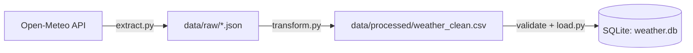

# data-pipeline-project

Verification code : WTC-BYKE72JJ

Youtube video link : https://youtu.be/fYvZSoDXrB0


# Weather Data Pipeline

A batch ETL (Extract, Transform, Load) pipeline that pulls historical daily weather data from the Open-Meteo API, cleans it, validates it, and loads it into a SQLite database.

## Architecture



| Step | File | What it does |
|---|---|---|
| Extract | `src/extract.py` | Fetches the last 30 days of weather for Cape Town and saves the raw JSON, untouched, with a timestamped filename |
| Transform | `src/transform.py` | Flattens the JSON, fixes data types, drops nulls and duplicates, adds a `temp_range_c` column, sorts by date |
| Validate | `src/load.py` | Checks for empty data, missing columns, nulls in key columns, and max temp lower than min temp |
| Load | `src/load.py` | Writes the clean data to the `weather` table in SQLite |
| Orchestrate | `src/pipeline.py` | Runs all steps in order with logging and error handling |

## Project structure

```
data-pipeline-project/
├── README.md
├── requirements.txt
├── data/
│   ├── raw/            # raw JSON from the API
│   └── processed/      # cleaned CSV + weather.db
├── src/
│   ├── extract.py
│   ├── transform.py
│   ├── load.py
│   └── pipeline.py
└── tests/
    └── test_transform.py
```

## Setup

```bash
git clone git@github.com:bafana49/data-pipeline-project.git
cd data-pipeline-project
python3 -m venv venv
source venv/bin/activate
pip install -r requirements.txt
```

## Usage

Run the full pipeline:

```bash
python src/pipeline.py
```

Or run each step on its own:

```bash
python src/extract.py
python src/transform.py
python src/load.py
```

Run the tests:

```bash
pytest tests/ -v
```

## Inspecting the output

```bash
sqlite3 data/processed/weather.db
sqlite> SELECT * FROM weather LIMIT 5;
```

## Tech stack

Python 3, pandas, requests, SQLite, pytest

## Project management

Progress was tracked with a GitHub Projects board and one issue per task. Each commit references the issue it closes.

## Possible improvements

- Schedule the pipeline to run daily (cron or Airflow)
- Support multiple cities
- Append new rows instead of replacing the table
- Add a chart or dashboard on top of the database